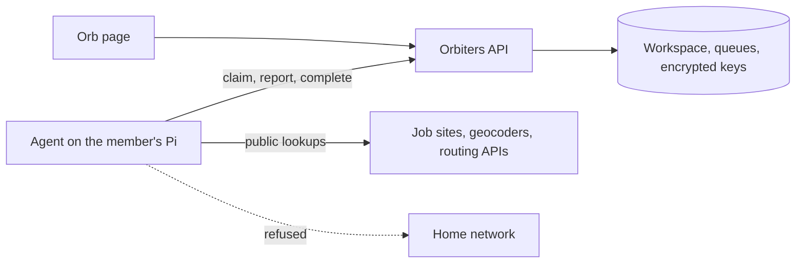

# ADR 0010 - Personal Agents on Member Hardware

## Status

Accepted for the alpha Orb workspace (called Me when this was decided; its assistant Orb was called Scout).

## Context

The Orb workspace replaces a personal job-search app that ran on one computer: it scraped job boards, searched
the web for offices and company evidence, and called routing APIs with the member's own keys. The member wants
to reach it from anywhere and to run more agents (a job worker, then the Orb assistant) on a Raspberry Pi at home.

Running those lookups on the Orbiters server would send its traffic, rate limits and blocks to every member,
and would put scraping code next to production data. Keeping everything on the Pi would mean hosting a
website on small hardware and storing keys there.

## Decision

- Orbiters stores the workspace, the queues and the keys, and serves the Orb page. It never performs the
  lookups.
- Each personal agent is a Steward-style agent account sponsored by the member, with its own revocable token.
  The job worker's token has `job-search:work` and `secrets:read`; Orb's has `agent-config:read`, `secrets:read`
  and `sponsor:read` (read-only AI app tools as the sponsor).
- Agents pull work: they long-poll for tasks, hold short leases, and every write carries the task generation.
  Orbiters paces each source and parks a route that asked to wait; agents only bound their own concurrency.
- Keys are stored encrypted as owner-scoped worker secrets. Each key names the agent kinds that may receive it,
  and a key is released only to the paired agent of that kind when it asks for it. The Orb page never shows a
  saved key again.
- On the Pi, each agent runs under its own system account with nftables rules that refuse the local network.

## Consequences

- Nothing scrapes from Orbiters' addresses, and a blocked source affects only that member's worker.
- The worker is a versioned part of the repository (`agents/job-worker`); its engine is the original app's code,
  connected through a small bridge, so rules such as merge order and source pacing did not have to be rewritten.
- A stolen agent token can read only the keys meant for that agent and write only to its sponsor's workspace;
  unpairing revokes it at once.
- Work waits while the Pi is offline. The Orb page says so instead of failing.
