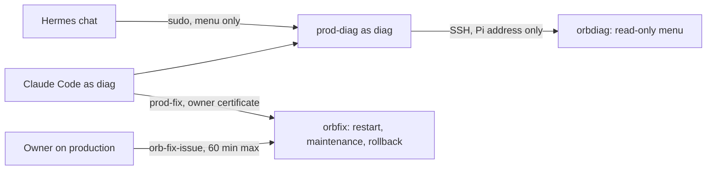

# Diagnose production remotely from the Pi

Read production's state from the owner's Raspberry Pi without a shell on production, and run the few operations that
need the owner's approval. The setup lives in `agents/diag` (its `README.md` holds the install and revocation
scripts and the threat model).



## Before you start

- You are on the Pi as `diag` (`ssh pi`, then `sudo -iu diag`), or in the diag Claude Code session (Remote Control
  from the Claude app). Hermes uses the same menu through its `prod_diagnose` tool once it is wired.
- Only `diag` can open a connection to production SSH from the Pi; `hermes` and every other user are refused by the
  `diag_egress` nftables table.

## Read production

Start broad, then narrow down. The menu allows 30 calls per 10 minutes.

```sh
ssh prod-diag health          # backend /healthz and /readyz, frontend, public URLs
ssh prod-diag ps              # running containers and stopped production ones
ssh prod-diag deploy-status   # deployed commits, last deployments, maintenance mode, release running now
ssh prod-diag logs backend-prod --since 30m --grep error
ssh prod-diag disk            # filesystems, Docker disk use, backup folders
ssh prod-diag mem
```

Logs are available for `backend-prod`, `frontend-prod`, `postgres-prod`, `caddy` and `cloudflared`, at most seven days
back. Tokens, keys, connection strings, cookies and e-mail addresses are masked before they leave production.

## Query the database

```sh
prod-diag sql 'SELECT id, username FROM "Users" ORDER BY id DESC LIMIT 5'
echo 'SELECT count(*) FROM "Assets"' | ssh prod-diag sql -
```

Queries run as `orbdiag_ro`: one `SELECT`, `WITH`, `TABLE`, `VALUES` or `EXPLAIN` statement, read-only, 10 seconds,
200 rows (`--limit` up to 1000). Columns holding secrets or personal data are not granted, so `SELECT *` fails on
those tables; list the readable columns first:

```sql
SELECT column_name FROM information_schema.column_privileges
WHERE grantee = 'orbdiag_ro' AND table_name = 'Users';
```

A daily timer re-applies the grants, so a table added by a release becomes readable the next day.

## Run an approved operation

Restarting a container, switching the maintenance page and rolling back the last release need a certificate.

1. The owner signs one on production, for up to 60 minutes and one scope:
   `sudo orb-fix-issue --reason "backend stuck after deploy" --scope restart:backend-prod`
   (scopes: `restart:<container>`, `maintenance`, `rollback`, `any`).
2. On the Pi, as diag: `prod-fix restart backend-prod` (or `prod-fix maintenance on`, `prod-fix rollback`,
   `prod-fix status`). The command fetches the certificate and shows its scope and expiry.
3. When done, the owner revokes it: `sudo orb-fix-issue --revoke`.

Rolling back reuses `scripts/deploy/rollback-prod.sh`; read its database caveat in
[Deployment and Backups](04-deployment-and-backups.md) first.

## Ship a code fix while away

Merging to `main` does not deploy. Push the fix as `hotfix/<YYYY-MM-DD>-<slug>`, let the owner review and merge it
into `main` from GitHub, then run the **Deploy production** workflow from the GitHub app with ref `main`. Back at the
PC, pull `main` into `dev` before the next `npm run release`.

## Audit and revoke

- Production: `journalctl -t orb-diag -t orb-fix -t orb-deploy-gate`. Pi: `journalctl -t prod-diag -t prod-fix`.
- Cut the Pi off immediately: `sudo bash ~orbit/orb-diag-src/diag/pi/revoke-pi.sh` on the Pi.
- Shut the production side: `sudo bash ~/orb-diag-src/diag/prod/revoke-prod.sh` on production.

## Deploy key restriction

The GitHub Actions deploy key only works from tailnet addresses and only for the commands the production workflows
send (`agents/diag/prod/deploy-gate`). If you change the backup or VPM bootstrap script inside those workflows,
regenerate `deploy-gate.allow` and copy it to production as the `agents/diag` README describes, or the next run is
refused with `orbiters-deploy-gate: refused` in the job log.
